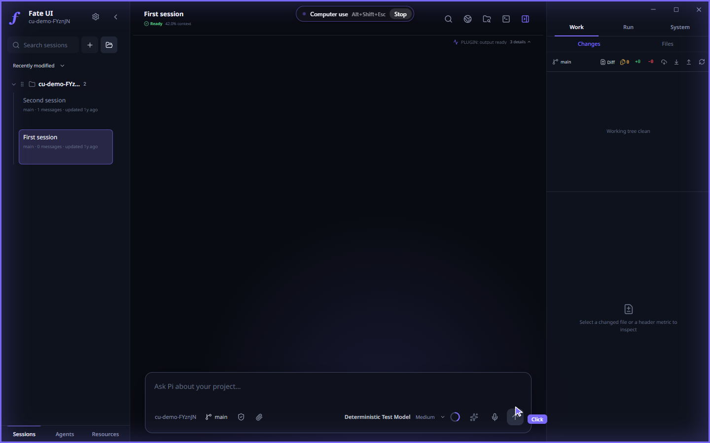

# Features

What Fate UI adds beyond the terminal Pi agent: transparent observability, first-class Git and files, a manual terminal and browser, native media, and themeable presentation.

## Flight Deck: see what your agents are doing

The Flight Deck is Fate UI's observability surface. It shows real Pi runtime state, not inferred or mocked activity.

- **Activity Pulse** — the live current-execution summary: runtime status, queue depth, context usage, changed files, and what is running right now (a tool, a writer node, a blocked agent).
- **Activity** — one merged chronology in the Run destination. It joins **live, bounded** session events (root, historical standalone, and Agent Team activity; 256-row window, **not durable**) with the current project's **direct-write ledger** rows. When a ledger record matches a retained `write`/`edit` tool row (same actor, path, operation, and a bounded time window), the two render as one row tagged `ledger`; ledger rows with no retained tool row still appear after a restart. A single row of toggles narrows the list — **Writes** (write/edit rows only) plus one of **Root / Historical / Team** — and no toggle selected shows everything.
- **Review Runway** — pairs working-tree diffs with review status (reviewed/unreviewed, navigate, mark, explain, test, revise).

### Honest about file attribution

When a diff shows a link to agent activity, that link is **related direct-file activity (path correlation)**, not causal provenance. It records the tool that *declared* an affected path. Keep these limits in mind:

- A failed `edit` can still be listed as related activity.
- A later manual edit to the same path can be attributed to an earlier tool.
- Two agents touching the same path are ambiguous.
- Shell commands, formatters, scripts, external editors, and manual terminal mutations are generally invisible.
- Commit history has no automatic causal link to recorded tool events.

So read these links as "related activity to investigate," never as proof of who caused the current file state.

### Direct-write ledger rows (limited)

Activity's ledger rows list successful direct `write`/`edit` tool calls, PDFs saved by `pdf_fill` and `pdf_create` (recorded as writes), and checkpoint `restore` operations for the current project: each row records the project-relative path, the actor (main agent, historical standalone agent, or team node), the permission level at write time, and a prior→post SHA-256 transition (or `new file` / `oversize prior` when no prior hash was captured). The list is virtualized and bounded to the most recent 1,000 rows shown.

It is deliberately narrow. It does **not** cover shell commands, formatters, scripts, external editor edits, manual terminal mutations, the current working-tree diff, or commit history. It records that a controlled write completed and produced the recorded written-content hash — not authorship, not causality, and not a durable audit log.

The SHA-256 values fingerprint the file content Fate supplied to the tool; they are **not** a signature, and the local JSONL ledger is **not tamper-evident** — a stored row can be edited or removed on disk without detection. Retention is bounded to 4,096 records, 16 MiB, and 90 days per project, and rows are local to the current process/profile slot: each `--new-instance` process keeps its own ledger and rows are not merged across processes.

### Checkpoints and Rewind

Every attested `write`/`edit` also stores the file's **prior bytes** in a content-addressed checkpoint store under the Fate data directory (`checkpoints/v1/<project-hash>/<sha256>`). A ledger row therefore doubles as a restore point. **Rewind** on an Activity ledger row restores every file the ledger touched from that row onward to its state **before** that row: hashed priors are written back, files the agent created are removed. Each restored file is recorded as a `restore` row with its own prior blob, so a rewind can itself be rewound. Rewind is refused while the session is streaming.

Rewind skips a file and reports why when its current content no longer matches the ledger (`changed`: a shell command, formatter, or external editor touched it), when the prior state was too large to capture (`oversize`, above 8 MiB), when the blob was evicted (`evicted`: the store keeps 256 MiB per project and 90 days), or when the path is not a regular file (`unavailable`). Bash, git, and formatters are invisible to the ledger and therefore to Rewind; Git remains the authority for anything outside direct tool writes.

## Hunk review

In the Review Runway, a text diff shows one row per hunk above the Monaco view. **Keep** marks a hunk as reviewed. **Reject** reverse-applies only that hunk with `git apply --reverse`, refreshes the diff, and drafts a feedback message with the rejected hunk for the agent. Untracked files have no hunks; revert the whole file instead. The hunk header is checked before the revert so a stale list never reverts the wrong lines.

## Pull requests

Full-access root sessions get `git_push`, `pr_create`, and `pr_status`. `git_push` pushes the current feature branch to `origin` with an upstream and refuses `main` and `master`. `pr_create` opens a GitHub pull request through the GitHub CLI and pushes first when the branch has no upstream. `pr_status` reports state, review decision, mergeability, every check, and the failed log tail of up to three failing workflow runs, so a "CI failed, fix it" prompt has the evidence in one call. The GitHub CLI must be installed and signed in; Fate never stores GitHub credentials.

## Context inspector

Before every provider request a Pi inline extension estimates what fills the context window: system prompt, active tool schemas, user and assistant messages, tool results, and the three largest tool results. It appears as the `context` widget in the extension status rail beside the composer. Token counts are UTF-8 byte estimates, not provider tokenization; the first line also shows the SDK's own context usage when it is known.

## Usage and budget

Every assistant turn records provider-reported tokens and cost into `usage/v1/<project-hash>.jsonl` under the Fate data directory, bounded to 20,000 rows and 8 MiB per project. **Settings → Usage** shows today, a 7 to 365 day window, cost per day, and the top models and sessions. **Settings → Agent → Daily budget** sets a per-device daily limit; when a project's spend for the day passes it, the root session shows a warning notice after the turn. The budget is an alarm, not a hard stop.

## Codemode and tool search

Root sessions load the Pi SDK's `tool_search` extension. Rarely used tools (agent orchestration, tasks, Monitor, session messages, image generation, branch, push and pull request tools, and `fate_mcp`) stay deferred until the model looks them up. **Settings → Agent → Codemode** also loads the `codemode` extension into new root sessions, so the model can run several tools from one script. Codemode is off by default.

## Web search and fetch

Root sessions, Agent conversations and Agent runs have two network tools at every permission level.

- `web_search` sends an objective and up to five queries to Parallel's free Search MCP at `search.parallel.ai` and returns up to 10 results as title, URL and excerpt, at most 16,000 characters. Searches time out after 45 seconds. Use of the service is subject to Parallel's customer terms and privacy policy. **Settings → Agent → Web search** turns it off: open sessions stop searching once the setting is saved, and turning it back on applies to new sessions.
- `web_fetch` reads one public http or https URL on port 80 or 443 and returns the page as markdown, or as text for plain text, JSON and XML. It returns 20,000 characters per call; `offset` continues a longer page. It refuses private, loopback, link-local, multicast and cloud-metadata addresses, checks every DNS answer and every redirect target, follows at most 5 redirects, stops after 20 seconds and reads at most 2 MiB. Images, PDFs and other binary types are refused. Fetching never goes through Parallel.

Agent Teams children do not get these tools. Use the embedded browser for pages that need scripts, clicks or sign-in.

## Hooks and Code Intelligence

**Hooks** (Settings → Hooks) run your own shell commands on the agent tool lifecycle: before a tool call, after a tool result, when the agent stops, and at session start. They apply to the root agent and every Agent Team member. See [Hooks](hooks.md).

**Code Intelligence** (Settings → Code Intelligence) gives the agent `lsp_diagnostics`, `lsp_definition`, `lsp_references`, and `lsp_symbols`, backed by language servers found on PATH or in the project's `node_modules/.bin`. Every `write`/`edit` result also carries fresh errors and warnings for the touched file. See [Code Intelligence](code-intelligence.md).

## First-class Git and files

Status, history, commits, Monaco diffs, and project-confined file browsing without leaving the app. Worktrees are switchable; the working-tree diff and branch history are both reachable. Isolated session and agent worktrees are plain Git worktrees inside the project at `.fate/worktrees/`; that directory is added to `.git/info/exclude` and hidden from the file tree, so the parent checkout stays clean. The server profile keeps them under its data root instead.

### Branches

The composer shows a branch chip for repository projects. On an empty session it opens a picker: switch to a local or remote branch, or create a branch from the current one by typing its name. Branches checked out in another worktree are listed with a **worktree** tag and open that worktree. Picking a branch while the working tree has uncommitted changes opens it in a managed worktree and leaves the changes on the current branch. Each local branch has a delete button with a confirmation; deleting also removes its worktree, and is refused while a running session uses that worktree or when the branch is checked out in the primary worktree. Once the session has a message the branch is fixed for that session and the picker is read-only. The agent names, switches, and renames branches through the `git_branch` tool (list, switch, create, rename), which runs with hooks and unsafe protocols disabled. Listing works at every permission level; switching, creating, and renaming need Edit files or Full access. Status, changes, and history refresh after the tool completes.

## Long conversations

A long session opens on its most recent window of history. Scroll up to load earlier messages in pages. Images outside the recent budget stay as placeholders and load when you open them. Attached and received images are grouped into two-per-row tiles that open the full-size viewer. Sessions of any project can be deleted from the sidebar.

## Computer use

The `computer` tool lets the agent take screenshots and use the mouse and keyboard: click, drag, scroll, type, key chords, zoom into a region and choose a display. Every action except `list_displays` and `cursor_position` returns a fresh screenshot.

- It is off until you turn it on in the permission menu of the composer or in **Settings → Workspace**, and it only works in a Full access session. Agent runs started from an Agent chat do not get it.
- Turning it on relaunches Fate UI elevated: a UAC prompt on Windows, an administrator prompt on macOS, `pkexec` on Linux. The app and everything it starts then run with administrator rights. On Windows the UAC secure desktop prompt is switched off while computer use is on and restored when it is turned off.
- An overlay shows only while the agent is acting and disappears when the turn ends. Its Stop button, or **Alt+Shift+Esc** (**⌥⇧Esc** on macOS), stops the session like the composer's Stop; computer use stays on. The switch is locked while a session is running, and computer use turns off when the last window closes.
- macOS needs Accessibility and Screen Recording permission. Linux needs an X11 or XWayland display.
- Everything on screen is untrusted input. The agent is told not to enter secrets or take irreversible actions without asking, but that is guidance, not a sandbox.

## PDFs

Root sessions, saved Agents and Agent Team members work with PDFs through three tools:

- `pdf_read`, at every permission level, returns the page count, document metadata, the AcroForm fields (name, type, current value, options, tooltip label, required and read-only flags) and the text of the selected pages, for example `pages: "1-3,7"`. One call returns up to 50,000 characters or 100 pages and names the pages to request next. Files can be up to 25 MiB. `read` refuses PDFs and points to `pdf_read`.
- `pdf_fill`, at Edit files and Full access, sets text, checkbox, radio, dropdown and list fields and saves a new PDF, by default `<name>-filled.pdf` next to the source. It overwrites the source only when the call sets `replaceSource`. It writes nothing when any field name or value is invalid, can flatten the form, and removes an XFA layer so viewers show the filled values.
- `pdf_create`, at Edit files and Full access, renders simple Markdown (headings, paragraphs, lists, quotes, code blocks, rules) to a new A4 or Letter PDF.

Both write tools use the same confined write path as `write`, so every saved PDF appears in Activity as a ledger row and can be rewound.

Limits: text comes from the PDF's text layer, so scanned pages return no text and there is no OCR. PDFs that rely on external CJK character maps can return incomplete text. Encrypted PDFs that open without a password can be read but not filled; password-protected PDFs cannot be read. Signature and button fields are listed but cannot be set. The built-in PDF fonts cover Windows-1252 only: other characters in `pdf_fill` values are saved and drawn by the PDF viewer, and such forms cannot be flattened; `pdf_create` prints them as `?`.

## Manual terminal and embedded browser

A manual terminal and an embedded browser sit alongside agent activity. The manual terminal is labeled and kept visibly **separate from Pi-generated tool activity**.

## Session references and direct session messages

Attach saved sessions as read-only context, or message a saved session without switching away from your current one. See [Sessions and processes](sessions-and-processes.md).

## Native media (optional)

- **Voice transcription** — local, settings-controlled models with bounded and verified downloads.
- **Ambient audio** — disabled by default; resolved through a bundled, pinned `yt-dlp` runtime and streamed without saving media into the project.
- **Generated images** — select an image model independently of the active chat model. Fate UI supports authenticated OpenAI, Google, OpenRouter, and ChatGPT OAuth routes, plus compatible custom Pi providers. Custom endpoints require HTTPS except on loopback addresses. Generated raster output is validated, rendered inline, and stored under `~/.pi/agent/generated-images/<session-id>/`.

See [FONT_LICENSES.md](../FONT_LICENSES.md) for bundled font redistribution notices.
